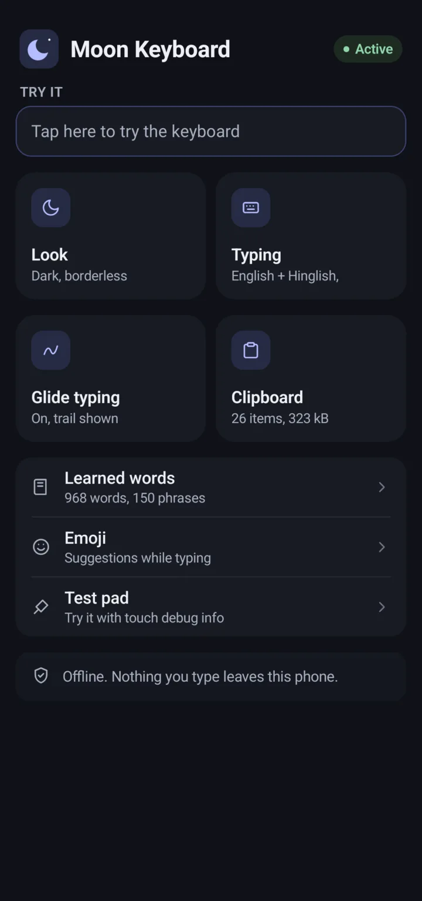
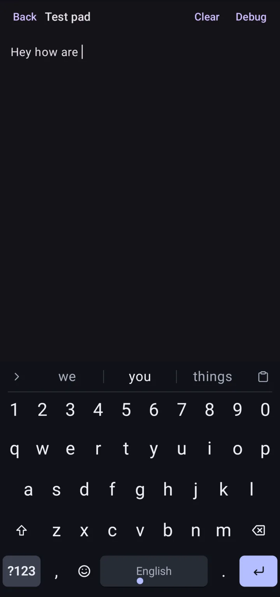
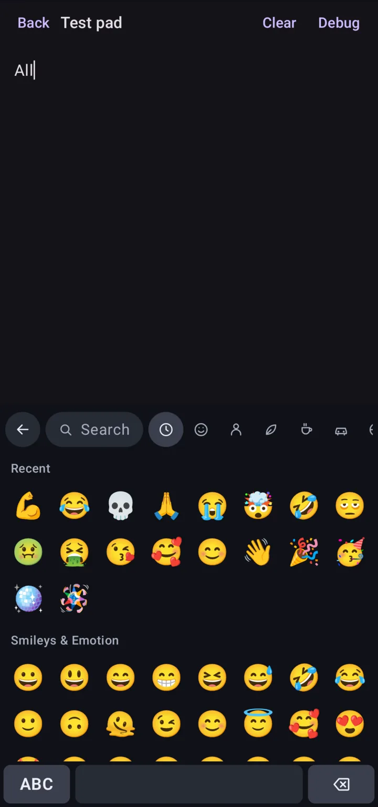

<div align="center">


# Moon Keyboard

### A fast, fully offline keyboard for Android

Glide typing, autocorrect and next-word prediction in English and Hinglish. The app has no internet permission, so nothing you type leaves your phone.

[](https://github.com/Moon-Ecosystem/MoonKeyboard/releases/latest)
[](https://github.com/Moon-Ecosystem/MoonKeyboard/actions/workflows/release.yml)
[](#download)
[](LICENSE)






</div>

## Download

Grab the latest signed APK from [Releases](https://github.com/Moon-Ecosystem/MoonKeyboard/releases/latest). Version tags publish a release such as **Moon Keyboard 0.1**, and every push to `main` publishes a numbered pre-release build.

_Requires Android 7.0 (API 24) or higher._

## Features

- **Glide typing**, with an optional fading trail.
- **Autocorrect and predictions**, helped by a small on-device neural model. Undo any correction with backspace.
- **Learns your words** on the device. Add your own words, text shortcuts ("omw" → "on my way") and saved email addresses.
- **Hinglish** ("kya kar rahe ho") alongside English.
- **More languages** as packs you add from a file ([MoonKeyboard-Languages](https://github.com/Moon-Ecosystem/MoonKeyboard-Languages)); hold space to switch.
- **Emoji** with search, and emoji suggestions as you type.
- **Clipboard** history with pinning, including images.
- **Password manager** suggestions in the strip (Android 11+).
- **Editing:** slide on space to move the cursor, slide from backspace to delete words, and a text-editing panel.
- **Layouts:** one-handed, floating and split.
- **Themes:** light, dark, pitch black, accent colours or Material You.
- **Incognito button**: nothing is learned while it's on.

## Privacy

- The app has no internet permission. It cannot send anything anywhere.
- Learned words, your clipboard and your settings stay on the device.
- Nothing is learned in password or incognito fields, or while the keyboard's incognito button is on.
- No analytics, ads or crash reporting.

## Building from source

You need JDK 17 or newer and an Android SDK with platform 37. The Gradle wrapper (Gradle 9.9.0) is included.

```sh
./gradlew :engine:test           # typing engine unit tests
./gradlew :app:assembleDebug     # debug APK
./gradlew :app:assembleRelease   # release APK
```

Debug builds of the keyboard UI are noticeably slower; use a release build to judge how it feels.

To sign with your own key, add these to the git-ignored `local.properties`. Without them the default debug key is used.

```properties
signing.storeFile=/path/to/upload.jks
signing.storePasswordFile=/path/to/upload.password
signing.keyAlias=upload
```

The English + Hinglish language pack (`app/src/main/assets/dict/en.dict`) is committed. To rebuild it, run `tools/fetch-data.sh` and follow the command in its header.

The project has three modules: `engine` (pure Kotlin decoding, suggestions and learning), `app` (the Android input method, built with Jetpack Compose) and `tools` (builds the language pack and emoji list). See [docs/architecture.md](docs/architecture.md).

## License

The code is distributed under the [MIT License](LICENSE). The language pack includes L3Cube-HingCorpus data, so the pack file itself is licensed under CC BY-NC-SA 4.0 (non-commercial). See [NOTICE](NOTICE) for all data sources and their licenses.
